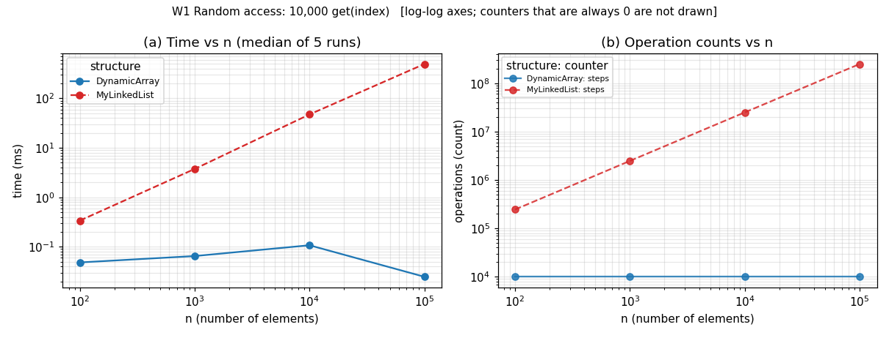
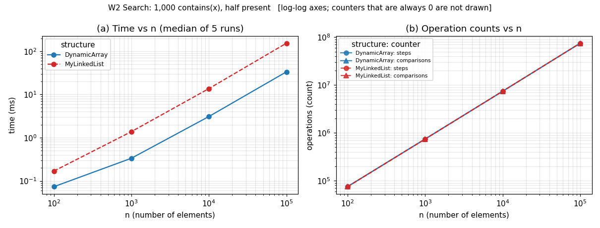
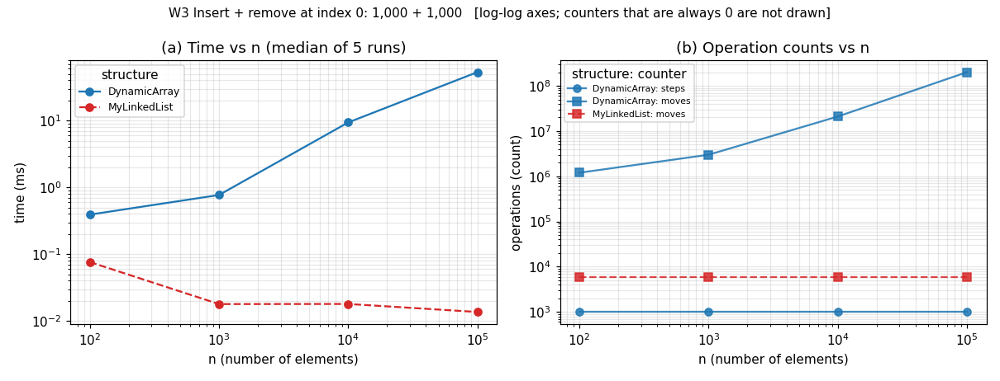
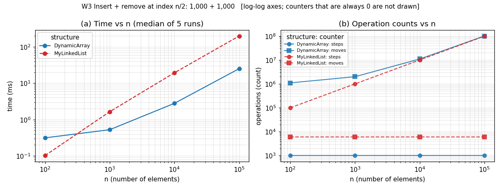
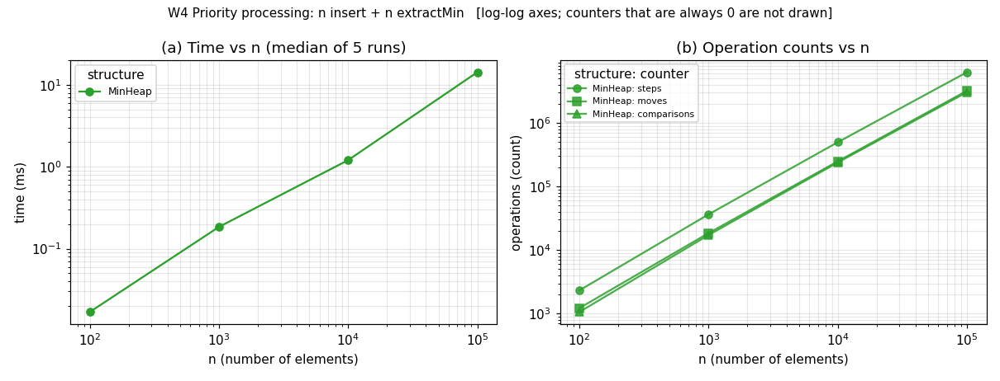

# DAA Assignment 2 – Report
**Nurdaulet Abdulla, SE2516**

## 1. Overview

Three structures were written from scratch, all storing primitive `int` (no generics, no `Integer`, no `java.util` collections): `DynamicArray` (`int[]`, doubles when full), `MyLinkedList` (doubly linked, `head`/`tail`) and `MinHeap` (array-based binary heap, 0-based). `DynamicArray` and `MyLinkedList` implement the same `IntList` interface, so one benchmark method runs both; all three expose their counters through `Metrics` (package `daa.metrics`). Invalid input throws `IndexOutOfBoundsException` (`get`, `add(index,x)`, `remove`) or `IllegalStateException` (`peekMin`, `extractMin` on an empty heap).

**Tests (JUnit 5, 33 tests, all passing).** Random operation sequences are compared with `java.util.ArrayList` / `PriorityQueue` (20 seeds × 3,000 operations each); edge cases cover an empty structure, one element, duplicates, first/last index and invalid indexes; the heap property `a[parent] <= a[child]` is checked after every insert and every `extractMin`; and n calls of `extractMin()` are checked to be non-decreasing and equal to the sorted input (n = 1 … 10,000). A few tests also check the operation counters, for example that `get` on the array costs exactly 1 step.

**Benchmark method.** `BenchmarkRunner` runs W1–W4 for n = 100, 1,000, 10,000, 100,000 with data from `new Random(42)`. A discarded global warm-up pass (n ≤ 10,000) lets the JIT compile both structures first; then each case has 3 discarded warm-up runs and 5 timed runs with a garbage collection before each, and the **median** is saved to `results/results.csv`. (An earlier version without the global warm-up showed n = 100 slower than n = 1,000 in W3-head: 1.59 ms vs 0.87 ms.) Counts are identical on every run; times vary slightly. Only the operations are timed, not the fill. Counters are incremented inside the methods: *steps* = one array-cell read or one move to the next node; *moves* = one element shifted/copied (a heap swap = 2) or one link update; *comparisons* = one comparison of two elements.

## 2. Complexity table

n = number of stored elements. Θ is used where the bound is tight for that case.

| Structure | Operation | Best | Average | Worst | Aux. space | Justification |
|---|---|---|---|---|---|---|
| DynamicArray | `add(x)` | Θ(1) | Θ(1) amortized | Θ(n) for one resizing call | O(1) (Θ(n) temporary copy while resizing) | Doubling makes n appends cost ≤ 3n writes in total. |
| | `add(i,x)` | Θ(1) (i = size) | Θ(n) | Θ(n) (i = 0) | O(1) (Θ(n) when resizing) | Shifts size − i elements; random i shifts n/2. |
| | `remove(i)` | Θ(1) (last) | Θ(n) | Θ(n) (i = 0) | O(1) | Shifts size − i − 1 elements left. |
| | `get(i)` | Θ(1) | Θ(1) | Θ(1) | O(1) | Direct indexing. |
| | `contains(x)` | Θ(1) (first) | Θ(n) | Θ(n) (absent) | O(1) | Linear scan; a random present value is found after ~n/2 reads. |
| MyLinkedList | `add(x)` | Θ(1) | Θ(1) | Θ(1) | O(1) (one node) | The `tail` pointer avoids any walk. |
| | `add(i,x)` | Θ(1) (i = 0 or size) | Θ(n) | Θ(n) (i ≈ n/2) | O(1) | Walk min(i, n−i) hops from the nearer end, then 4 link updates. |
| | `remove(i)` | Θ(1) (first/last) | Θ(n) | Θ(n) (i ≈ n/2) | O(1) | Same walk, then 2 link updates. |
| | `get(i)` | Θ(1) (first/last) | Θ(n) | Θ(n) (i ≈ n/2) | O(1) | Walk min(i, n−1−i) hops; average ≈ n/4. |
| | `contains(x)` | Θ(1) (first) | Θ(n) | Θ(n) (absent) | O(1) | Linear walk. |
| MinHeap | `insert(x)` | Θ(1) (x ≥ parent) | Θ(1) for random keys | Θ(log n) (new minimum); Θ(n) for a resizing call | O(1) (Θ(n) when resizing) | Bubble-up climbs ≤ ⌊log₂ n⌋ levels; a random key rarely climbs far. |
| | `peekMin()` | Θ(1) | Θ(1) | Θ(1) | O(1) | Reads `heap[0]`. |
| | `extractMin()` | Θ(1) (all keys equal) | Θ(log n) | Θ(log n) | O(1) | The moved leaf usually sinks to the bottom: ≤ ⌊log₂ n⌋ levels, 2 comparisons per level. |
| Whole structure | storage | | | | Θ(n) each | Array: up to 2n cells of 4 bytes; list: n nodes (~24 bytes each: header + `int` + 2 references); heap: up to 2n cells. |

Measured check (`results.csv`): W4 needed ~3.06 million comparisons for n = 100,000, about 1.8·n·log₂n, in line with n·Θ(log n) for the inserts and extractions together.

## 2. Loop invariant proofs

### 2.1 `DynamicArray.contains(x)`
```java
for (int i = 0; i < size; i++) {
    if (data[i] == x) return true;
}
return false;
```
**Invariant:** before every iteration with index `i`, no element of `data[0..i-1]` equals `x` (and `0 <= i <= size`).

**Initialization:** before the first iteration `i = 0`, so `data[0..-1]` is empty and the statement is vacuously true.

**Maintenance:** assume the invariant holds before iteration `i` and the loop body runs (`i < size`). If `data[i] == x` the method returns `true` and the loop ends. Otherwise `data[i] != x`, so together with the invariant no element of `data[0..i]` equals `x`. After `i++` this is exactly the invariant for the new `i`.

**Termination:** the loop stops without returning when `i = size`. The invariant then says no element of `data[0..size-1]` equals `x`, i.e. `x` is not in the array. `i` grows by 1 each iteration and is bounded by `size`, so the loop terminates.

**Conclusion:** if the method returns `true`, it found an index with `data[i] == x`, so `x` is present. If it returns `false`, termination plus the invariant show every stored element differs from `x`. So `contains` returns `true` iff `x` is in the array.

### 2.2 `MinHeap.bubbleDown()` (called by `extractMin`)
```java
int i = 0;
while (true) {
    int l = 2*i+1, r = l+1, s = i;          // s = index of the smallest of i, l, r
    if (l < size && heap[l] < heap[s]) s = l;
    if (r < size && heap[r] < heap[s]) s = r;
    if (s == i) break;
    swap(i, s);
    i = s;
}
```
(The real code also increments the operation counters; they do not change the logic.)
Before the call, `extractMin` has put the old last element at the root and decreased `size`. Call the pair (`p`, `c`) *good* if `heap[p] <= heap[c]`.

**Invariant:** before every iteration (at position `i`):
1. every parent–child pair in `heap[0..size-1]` is good, except possibly the pairs (`i`, left child) and (`i`, right child); and
2. if `i > 0`, then `heap[parent(i)] <= heap[c]` for each child `c` of `i`.

**Initialization:** `i = 0`. Before the extraction the heap was valid. Moving the last element to the root and shrinking `size` removes pairs and changes only `heap[0]`, so only pairs involving the root can be bad, which is allowed by (1). The root has no parent, so (2) is vacuous.

**Maintenance:** suppose the invariant holds at `i` and the body runs with `s != i`. Then `s` is the child of `i` holding the smaller value, `heap[s] < heap[i]`, and `heap[s] <= `the other child. We swap, so the new `heap[i]` is the old `heap[s]` and the new `heap[s]` is the old `heap[i]`. Check the pairs around `i`:
- (`parent(i)`, `i`): by (2), `heap[parent(i)] <=` old `heap[s]` = new `heap[i]`. Good.
- (`i`, `s`): new `heap[i]` = old `heap[s] <` old `heap[i]` = new `heap[s]`. Good.
- (`i`, other child): new `heap[i]` = old `heap[s] <=` that child, by choice of `s`. Good.

Now set `i = s`. The only pairs that might be bad are those between `s` and its children, which is (1) for the new `i`. For (2): the parent of the new `i` is the old `i`, which holds old `heap[s]`. The children of `s` were not exceptions before, so their pairs with `s` were good: old `heap[s] <=` each child of `s`. So (2) holds.

**Termination:** each iteration moves `i` to a child, so `i` strictly increases. Since `i < size` is needed for any child to exist, the loop ends after at most `log2(size)` swaps. It exits via `break` when `s == i`, meaning `heap[i]` is `<=` all of its existing children (or `i` has no children), so the pairs (`i`, children) are good too.

**Conclusion:** at exit the exception in (1) disappears, so every parent–child pair is good and the array is a valid min-heap again. Together with `extractMin` returning the old `heap[0]`, which was the minimum, this proves `extractMin` is correct, in O(log n) time.

## 3. Plots

Every figure shows (a) median time vs n for both structures on one chart and (b) steps / moves / comparisons vs n. Both axes are logarithmic; counts that are always 0 are not drawn.

**W1 – random access (10,000 `get`)**


**W2 – search (1,000 `contains`, half present, half absent)**


**W3 – insert & remove at the head (1,000 + 1,000)**


**W3 – insert & remove in the middle, index n/2 (1,000 + 1,000)**


**W4 – priority processing (n `insert`, n `extractMin`, order checked)**


Key numbers at n = 100,000: W1 array 10,000 steps / list ≈ 250 million steps (0.025 ms vs 495 ms); W2 both ≈ 75 million comparisons (33.5 ms vs 154 ms); W3 head array ≈ 201 million moves / list 6,000 link updates (53.1 ms vs 0.014 ms); W3 middle array ≈ 101 million moves (25.2 ms) / list ≈ 100 million steps (200 ms); W4 heap 14.3 ms. Times under about 1 ms are dominated by timer resolution and JIT effects and can still be non-monotonic in n (for example W1 on the array is faster at n = 100,000 than at n = 10,000), so the exact counts are the more reliable evidence there. The counters add a small constant overhead to every method, equally for all structures.

## 4. Discussion

(a) `get(i)` on `DynamicArray` is a single address calculation and one memory read, while `MyLinkedList.get(i)` has to walk about n/4 nodes on average, which is why W1 needed 10,000 steps for the array and about 250 million for the list at n = 100,000. Even for a plain scan the array wins, because its ints are contiguous: one 64-byte cache line holds 16 of them, so one memory fetch serves 16 consecutive reads, and the hardware prefetcher can load the next lines before they are needed (spatial locality). The heap benefits in the same way, because parent and child positions are computed arithmetically inside one contiguous block. (b) In W2 both structures performed the same ≈ 75 million comparisons, yet the list took about 5 times longer (154 ms vs 33 ms), and in W3-middle the array's ≈ 101 million shifts finished about 8 times faster than the list's ≈ 100 million hops. A list node is a separate object with an object header, the `int` and two references (about 24 bytes against 4 bytes per array element), so a cache line holds only 2–3 nodes and much more memory has to be streamed. Walking a list is also pointer chasing: the address of the next node is known only after the current node has been loaded, so the CPU cannot overlap the loads or prefetch ahead, whereas array shifts and scans are independent loads that run at memory bandwidth. Every node is also a heap object that the garbage collector has to track and may move, which adds work and can scatter nodes in memory over time. Our benchmark allocated the nodes back-to-back, which is close to the best case for the list, so with many random inserts and removals in a long-lived list the gap would probably be larger. (c) `MyLinkedList` is the better choice when most changes happen at the head or at a position that is already known: in W3-head it needed only 6,000 link updates and ~0.014 ms against ≈ 201 million shifts and 53 ms for the array, and it never has to copy everything when it grows. `MinHeap` is the better choice when the smallest element is requested repeatedly while new elements keep arriving, such as a task scheduler, Dijkstra's algorithm or a top-k filter: `peekMin` is O(1) and each insert or extract costs O(log n), whereas an array or list needs an O(n) scan or an O(n) sorted insert per operation (W4 handled 100,000 inserts plus 100,000 extractions in 14 ms). For random access, searching by index, or iteration, the `DynamicArray` remains the default choice.

## 5. How to reproduce

`./run_benchmark.sh` compiles the code, runs all workloads with seed 42, and writes `results/results.csv` and `results/plots/*.png` (about 2 minutes). `mvn test` runs the 33 JUnit tests. See `README.md` for details.

## 6. Git workflow

`main` holds only working code and is tagged `v1.0`. Work was done on `feature/metrics` (counters, interface, benchmark, results, plots), `feature/array`, `feature/list` and `feature/heap`, merged with `--no-ff`; commits are small and use messages such as `feat(array): ...`, `test(heap): ...`, `docs(report): ...`. `git log --graph --oneline --all` shows the history.
